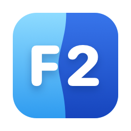

# F2

(It was called Finder2: "Finder" is Apple's, so F2 it is.)

**[Download F2](https://download.getf2.com/F2.dmg)** for macOS 13 and
later, on Apple silicon and Intel, at [getf2.com](https://getf2.com). It's
free, and its extensions are in their own repo,
[getf2/extensions](https://github.com/getf2/extensions).

**A passion project, in the open.** F2 is made by one person, for the fun
of it, and it's free. Issues are welcome: what's broken, and what
you'd like. For a pull request, open an issue first, so we can agree on it
before you put the time in. There's no promise of support, but every
report gets read.

**License:** [GPL-3.0](LICENSE). You may change F2 and share what you
make, as long as it stays under the GPL, its source with it. The name F2
and its icon are for the builds made here: a version of yours gets a name
and an icon of its own.

A Finder alternative for macOS: a [GPUI](https://gpui.rs) app (through
[gpui-kit](https://gpui-kit.com)) laid out like Finder on macOS 26, with
[fsearch](https://github.com/noahdunnagan/fsearch) linked in as its
search engine. It started as a question: does a GPU-rendered UI on a
sub-millisecond whole-disk index feel faster than Finder + Spotlight?

## What it does

- **A Finder, quicker**: windows and tabs, icons, list, columns and
  gallery, two panes, archives opened like folders, your servers over SSH,
  and search as you type across the whole disk.
- **Quick Open**, a launcher over any app (⌘Space): apps, files and
  commands, answers as you type (sums, money, the time anywhere,
  translations, the weather…), the clipboard's history, emoji, snippets.
- **Disk space**: Disk Usage, Free Up Space, Uninstall App, Tidy Up, and
  Folder Rules that keep a folder in order on their own.
- **Screenshots and recordings**: an area, a window, a screen, the text in
  it, a color, or a long page whole, with an editor to mark them up.
- **Window management** from the keyboard: halves, thirds, maximize,
  center, other displays.
- **Extensions** for the services you use, from the Extension Store, or
  your own in JavaScript ([EXTENSIONS.md](EXTENSIONS.md)).

All of it, in a list: [FEATURES.md](FEATURES.md) (and
[getf2.com/features](https://getf2.com/features)). How each part works,
what it asks the internet for, and the keys: [docs/GUIDE.md](docs/GUIDE.md).

## Building it

You need macOS 13 or later, [Rust](https://rustup.rs), and Xcode's command
line tools (`xcode-select --install`: F2's Objective-C and Swift parts are
built with them).

```
./scripts/bundle-macos.sh --install   # builds F2.app into /Applications
cargo run --release -- ~/Developer    # or run it from here, opening there
```

The first launch crawls the whole disk into fsearch's index (about 20 s
for 4M entries) at `~/Library/Application Support/FSearch`, the same one
the `fsearch` CLI uses: whichever starts first owns it, the other follows.
Later launches load it instantly and replay only what changed. Set
`NEW_FINDER_INDEX_DIR=/some/dir` to keep a separate one.

fsearch is vendored in `vendor/fsearch`, with read access to its live
index added, which folder sizes are added up from (see `vendor/README.md`).

Without Full Disk Access the index skips Desktop, Documents, Downloads,
iCloud and `/Volumes`, the Trash can't be read or emptied, and macOS asks
about each guarded folder as it's opened. F2 asks for it once, at
first launch (then the sidebar keeps a link to it). The bundle is signed
with your Developer ID (else your Apple Development certificate, or
`SIGN_IDENTITY`), so grants outlast rebuilds; signed ad hoc, they'd have
to be given again after each one. (Grants go with the certificate: after
a switch between them, they're given once more.)

Settings, folders' views, Favorites and the window's frame are kept in
`~/Library/Application Support/NewFinder/settings.json`; its log, in
`Logs/F2.log` there (Help > Show Log File), when it's opened as an app.

## Releases

GPUI has no updater of its own (Zed wrote its own), so F2 uses
[Sparkle](https://sparkle-project.org), as most Mac apps outside the App
Store do. `scripts/release-macos.sh` builds F2 signed with your Developer
ID and the hardened runtime, has Apple notarize it, staples the ticket
to the app and to a DMG (laid out by dmgbuild: `scripts/dmg-settings.py`,
over `scripts/render-dmg-background.swift`'s arrow), and writes Sparkle's
`appcast.xml` (each update signed with an EdDSA key from your keychain)
into `target/release/dist`;
with `--publish`, it uploads them (with wrangler) to the `f2-updates` R2
bucket, served at https://download.getf2.com: `F2.dmg` is the latest. The
app checks `appcast.xml` there once a day, and on Check for Updates….
(Builds from `bundle-macos.sh` update themselves only where Sparkle's key
is in the keychain: your own.) F2 0.1.6 and earlier check
https://f2.dagurleo.com instead, which serves the same bucket: keep that
domain on it.

Once, before the first release (see the script's header):

```
xcrun notarytool store-credentials F2APP --apple-id <you> --team-id FTASJZ6Z7N
target/sparkle-2.10.0/bin/generate_keys     # after one bundle-macos.sh run
./scripts/release-macos.sh --publish        # each release, once committed
```

A release's version is Cargo.toml's (bump it for each); its build number,
189 plus the commit count (its history began again at 0.2.0, when it
went open source). A release runs on Apple silicon and Intel: built for
both and put in one app with lipo, so the Mac it's made on needs Rust's
target for the other chip (`rustup target add x86_64-apple-darwin`). F2
runs on macOS 13 and later: `.cargo/config.toml` builds it for that, and
an API newer than that without `@available` is a build error. Help > Acknowledgements lists every dependency's
license (`scripts/licenses.py`, from `cargo metadata`, with Sparkle's).

## The code

[docs/ARCHITECTURE.md](docs/ARCHITECTURE.md) says where everything is.
In short: `src/` the app (`src/finder/` the window, `src/quick_panel.rs`
Quick Open, `src/macos/` what only Objective-C and Swift can reach),
`extensions/` the extension template and F2's API's types, `vendor/`
fsearch, `scripts/` building and releasing, `site/` getf2.com, and
`video/` the feature video.

## Not yet

Finder Sync extensions' badges (Dropbox's), which only run in Finder; a
VoiceOver pass (the main parts have roles and labels, not every control).
